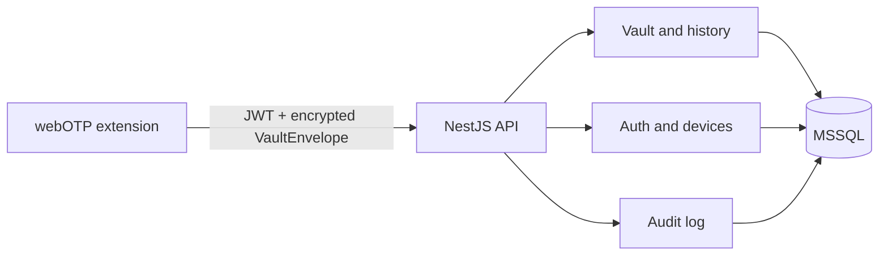

# Architecture

webOTP-server is a zero-knowledge synchronization service. The browser extension
encrypts the vault before upload; the server stores and returns only the opaque
`VaultEnvelope` (version 2, salt, and ciphertext). It never generates OTPs,
derives the user's vault key, or stores plaintext OTP entries.

## Key security model

The extension uses a two-password model: the account password authenticates the
user to the service, while a separate master password derives the local vault
encryption key. The account password is bcrypt-hashed server-side. Refresh
tokens are stored as SHA-256 hashes. Vault ciphertext is persisted without
decryption, and all server logs redact credentials, tokens, secrets,
authorization values, and ciphertext.

## API overview

All API routes are under `/api/v1` and protected routes require a bearer JWT.

| Area    | Routes                                                                |
| ------- | --------------------------------------------------------------------- |
| Health  | `GET /health`, `GET /api/v1/health`                                   |
| Auth    | `POST /auth/register`, `/auth/login`, `/auth/refresh`, `/auth/logout` |
| User    | `GET /me`, `PATCH /me/preferences`, `DELETE /me`                      |
| Devices | `GET /devices`, `DELETE /devices/:id`                                 |
| Vault   | `GET /vault`, `PUT /vault`, history and restore routes                |
| Docs    | `GET /api/docs` when enabled                                          |

`PUT /vault` accepts an optional `Idempotency-Key` header. A successful request
can be safely retried with the same key and body for 24 hours.
